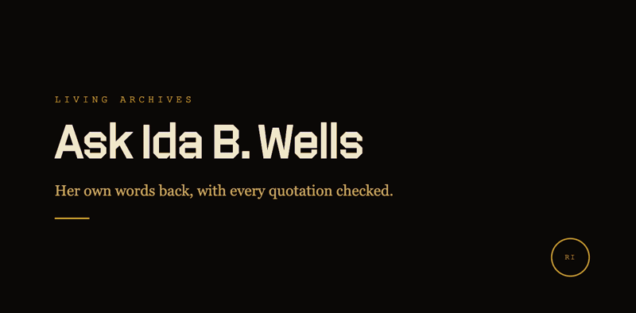

# Living Archives

Archives of one person's writing that you can ask questions in plain language. The answer quotes the writing and names the book and chapter.

Try them:
- [The Ida B. Wells Living Archive](https://ida-b-wells-living-archive.vercel.app): five of her public-domain works, 1892 to 1920. Quote checking is live here.
- [The Du Bois Living Archive](https://dubois-living-archive.vercel.app): W.E.B. Du Bois's public-domain writing and the 1900 Paris data plates. Quote checking is built and coming soon.
- [The Marcus Garvey Living Archive](https://garvey.radicalimagination.xyz/sam), made with the Black Star Archive: a search of Garvey's own words.

There's also a [30-second demo video](https://radicalimagination.xyz/demos/living-archives.mp4), silent with captions.

## How it works

- A question searches only that archive's texts, and the model writes its answer from the passages it found.
- A checker compares the quotes in the answer with those passages and marks them verified or unverified. It allows for OCR errors in old scans and catches a changed word.
- Chapter citations come from each book's own table of contents, so you can look them up.
- If the archive has no word for a modern term, the answer says so.

## Why there's a checker

We tested our archives with 54 questions like the ones visitors ask: slang, words whose meaning has changed, and ideas a writer practiced without naming them. The early versions failed in specific ways. One quoted other writers as if they were the person the archive is about. The checks above came out of those failures, and people still review the archives.

## How it's built

Retrieval over vector search (pgvector or Firestore, depending on the archive), embeddings, a streamed answer, and a quote checker with its own tests. React and Vite front ends on Vercel.

The app code is in private repositories; this repo is the public page for them.

Made by [Radical Imagination](https://radicalimagination.xyz), a cultural technology studio in Queens.
